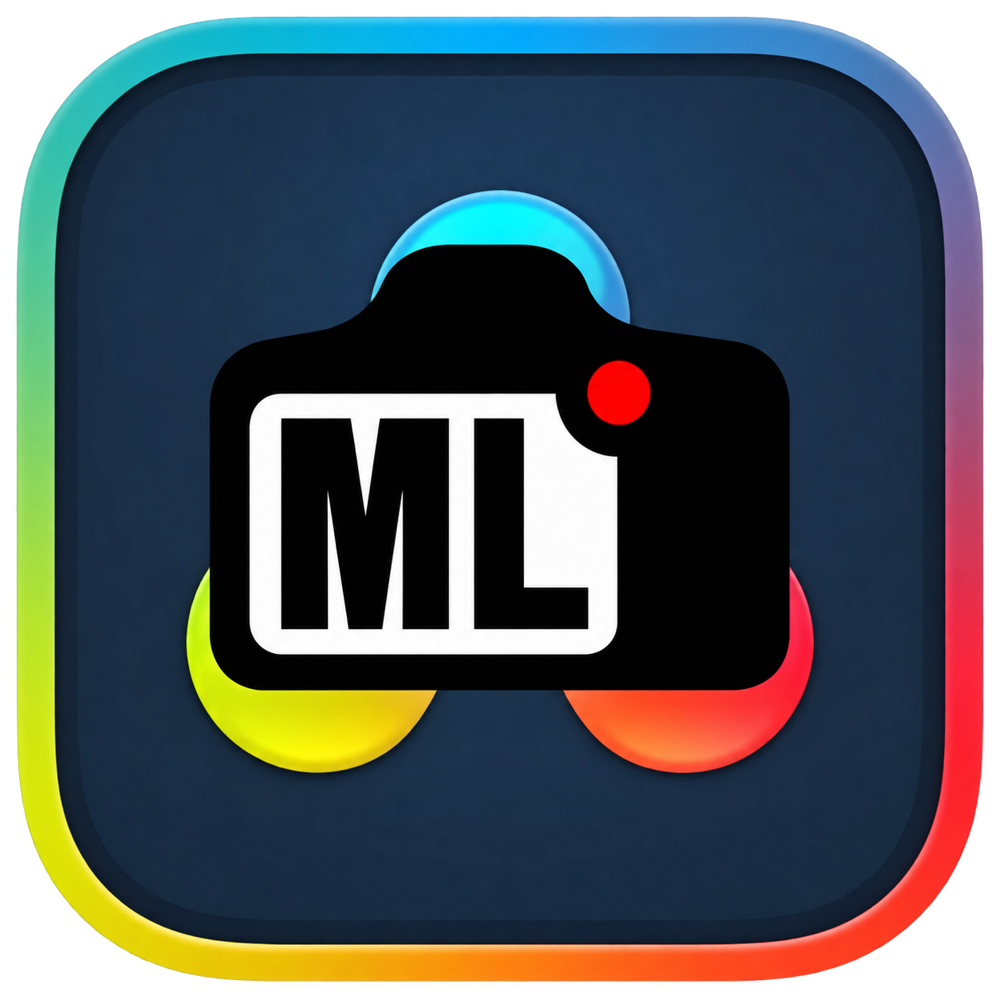

# mlv2Resolve

*[English version](README.md)*

Montez vos **rushs Magic Lantern MLV directement dans DaVinci Resolve**, sans conversion ni copie préalable. mlv2Resolve présente vos tournages sous forme de séquences CinemaDNG virtuelles, prépare un projet Resolve et peut synchroniser les données gyro d’un SenseFlow A1.

## Téléchargement et installation

**[Télécharger mlv2Resolve 0.2 pour Apple Silicon](https://github.com/julienbeka/mlv2Resolve/releases/download/v0.2/mlv2Resolve-0.2-macos-arm64.zip)** · [Notes de version et empreinte SHA-256](https://github.com/julienbeka/mlv2Resolve/releases/tag/v0.2)

- **Mac :** Apple Silicon, macOS 14 ou ultérieur. L’interface intègre les icônes et l’apparence natives de macOS Tahoe.
- **Resolve :** testé avec DaVinci Resolve Studio 21.1.1. Studio permet les actions directes depuis l’app ; l’édition gratuite utilise le script Workspace décrit plus bas.
- **FUSE-T :** nécessaire aux montages virtuels. L’app propose son installation s’il manque.
- **Gyroflow(NiYien) OFX :** nécessaire uniquement à la stabilisation dans Resolve ; à installer séparément.

1. Décompressez le téléchargement et placez `mlv2Resolve.app` dans `/Applications`.
2. L’app n’est pas notarisée : si macOS bloque le premier lancement, utilisez **Réglages Système → Confidentialité et sécurité → Ouvrir quand même**.
3. Ouvrez l’app et terminez l’installation de FUSE-T si elle est proposée. La fenêtre principale s’affiche au lancement ; l’app apparaît aussi dans le Dock et dans **⌘ Tab**. Son icône d’appareil photo **ML** dans la barre des menus donne un accès rapide au workflow.

Pour vérifier le téléchargement, placez le ZIP et son fichier `.sha256` dans le même dossier, puis lancez `shasum -a 256 -c mlv2Resolve-0.2-macos-arm64.zip.sha256`.

Le français et l’anglais sont inclus. L’interface suit macOS ; choisissez une autre langue dans **Réglages → Langue**.

## Démarrage rapide

La fenêtre comporte quatre sections :

| Section | Utilisation |
| --- | --- |
| **Rushs** | Choisissez un dossier de tournage ou un dossier parent contenant plusieurs tournages. Montez chaque dossier avec son interrupteur ; **Tout démonter** se trouve ici. |
| **Synchro gyro** | Si vous utilisez un SenseFlow A1, choisissez un objectif et une position du capteur, puis attendez la synchronisation. Les vignettes désanamorphosées et les aperçus agrandis facilitent l’identification des plans. |
| **Montage** | Saisissez un nom de projet puis cliquez sur **Créer projet**. Tous les dossiers montés sont réunis dans **un seul** projet Resolve. |
| **Réglages** | Ouvrez le tiroir gauche pour régler les objectifs, le Dual ISO, la taille du projet, la cadence et la timeline All shots facultative. |

Les séquences DNG apparaissent dans `~/MLV Mounts/<tournage>`. Gardez les dossiers montés pendant le montage. Ils sont remontés au lancement de l’app et à la reconnexion de leur disque, avec les mêmes chemins pour que Resolve retrouve les plans.

## Workflow Resolve

Avec **Resolve Studio**, activez **Preferences → System → General → External scripting using: Local**. Avec **Resolve gratuit**, choisissez l’action dans mlv2Resolve puis lancez **Workspace → Scripts → mlv2Resolve** dans Resolve.

| Action | Résultat |
| --- | --- |
| **Créer projet** | Crée un seul projet nommé à partir des tournages montés, importe les CinemaDNG et les WAV associés, et synchronise l’audio par timecode. |
| **Ouvrir projet** | Retrouve un projet lié sans changer ses médias, timelines ou grades. |
| **Ouvrir Resolve** | Lance Resolve. |
| **Désqueezer dans Resolve** | Désanamorphose les plans déjà en timeline, en préservant les cadrages personnalisés et sans appliquer deux fois l’étirement. |

Dans **Réglages → Resolve** :

- **Taille du projet :** Automatique utilise la résolution désanamorphosée majoritaire des rushs montés ; UHD ou HD adapte le zoom pour montrer l’image entière, avec des bandes si nécessaire.
- **Cadence :** utilisez la cadence majoritaire des rushs ou choisissez une valeur manuelle. La cadence de timeline du projet et sa cadence de lecture sont préparées à la même valeur.
- **All shots :** ajoutez facultativement tous les plans importés à une timeline. L’option est activée par défaut ; son nom est modifiable et vaut **All shots** par défaut. Désactivez-la pour préparer une timeline vide avec ses CST.
- **Liens de projets :** effacez les associations mémorisées par l’app sans supprimer les projets Resolve ni les rushs.

Les nouvelles timelines remplies reçoivent un nœud Color **Gyroflow(NiYien)** sur chaque plan si le plugin est installé. Dans le plugin, utilisez **Load for current file** pour charger les données `.gyroflow` de ce plan. L’absence du plugin est signalée.

### Gestion des couleurs

L’espace de travail et de sortie du projet est **DaVinci Wide Gamut / DaVinci Intermediate**. La timeline préparée hérite des réglages du projet et comporte deux CST :

| Nœud de timeline | Conversion | État initial |
| --- | --- | --- |
| **CST 01** | P3-D60 / Linear → DWG / Intermediate ; **Apply Forward OOTF** coché | Activé |
| **CST 02** | DWG / Intermediate → Rec.709 / Rec.709-A | Désactivé |

**Activez le CST 02 uniquement avant un export Rec.709.** Les modèles portables sont inclus dans l’app : les autres utilisateurs n’ont aucun CST ni préréglage de projet à préparer. Adaptez les préférences Camera Raw dans le projet créé si besoin. Ces valeurs s’appliquent aux nouvelles créations ; ouvrir un projet lié conserve ses réglages existants.

### Rushs anamorphiques et Dual ISO

Les aperçus MLV sont automatiquement désanamorphosés. Les plans des timelines créées montrent l’image entière même sans préréglage Input Sizing, grâce à un zoom horizontal et vertical distinct. Les plans importés uniquement dans le Media Pool peuvent encore nécessiter un préréglage Input Sizing lors de la création manuelle d’une autre timeline.

Utilisez le mode Dual ISO **Montage fluide** pendant le montage et **Qualité étalonnage** avant l’étalonnage ou l’export. La bascule s’applique à chaud ; sélectionnez les plans dans Resolve puis utilisez **Refresh** après le changement. Les deux modes sont expliqués dans les réglages.

### Synchro gyro (SenseFlow A1)

mlv2Resolve synchronise tout seul le gyro d'un SenseFlow A1 avec vos plans et écrit un projet Gyroflow par plan, pour
que le plugin Gyroflow de Resolve stabilise les DNG. Plus besoin de NiYien Tool ni de clips de référence.

1. Copiez les logs de l'A1 (`*_mix.bin`) n'importe où dans le dossier choisi avec **Choisir un dossier…** (le
   dossier du tournage, un sous-dossier, ou un dossier parent commun à plusieurs tournages). Les logs et les MLV
   ne sont jamais modifiés.
2. Déclarez vos objectifs une fois dans **Réglages… → Objectifs** : un nom et la vraie focale en mm (celle que
   Magic Lantern écrit dans le MLV n'est pas fiable). mlv2Resolve calcule un profil sans distorsion à partir de la
   focale.
3. Dans la fenêtre mlv2Resolve, chaque tournage monté a un **Objectif** par défaut et une **Position du capteur**
   (l'emplacement de l'A1 sur la caméra ; **Dessus** par défaut, modifiable dans **Réglages… → Synchro gyro**, ce
   qui s'applique aux plans synchronisés ensuite). Le menu de chaque plan permet de choisir un autre objectif ou une
   autre position pour ce plan seulement. Changer l'objectif ou la position d'un tournage réécrit les `.gyroflow`
   que mlv2Resolve a écrits pour ses plans sans objectif ni position propres (les fichiers précédents sont
   sauvegardés) ; les fichiers que mlv2Resolve n'a pas écrits ne sont jamais touchés.
4. Les plans sont synchronisés en arrière-plan, un à la fois par tournage. Chaque plan affiche son état :
   **Synchronisé (R² 0,78)** (le R² indique à quel point le mouvement du plan correspond au gyro, 1 = parfait),
   **Aucun log ne couvre ce plan**, **Mouvement de caméra insuffisant**, **Correspondance incertaine** (rien
   n'est écrit plutôt qu'une synchro douteuse), **Synchronisation…**, **.gyroflow existant**.
5. Le `.gyroflow` est enregistré à côté du `.MLV` (nommé comme celui de NiYien,
   `<dossier du plan>_000000.gyroflow`) et apparaît dans le dossier du plan du montage. Dans Resolve : plugin
   Gyroflow → **Load for current file**.

Les objectifs courts (p. ex. 12 mm) ont trop de distorsion pour un profil calculé : calibrez l'objectif dans
Gyroflow, puis importez son `.json` dans **Réglages… → Objectifs → Modifier… → Importer un profil calibré…**
(mlv2Resolve en garde une copie dans `~/Library/Application Support/mlv2Resolve/lens-profiles`). Un profil calibré sert
aux plans dont le format correspond à ses dimensions ; les autres gardent le profil calculé. L'état du plan
indique lequel a été utilisé (« profil calibré » / « profil calculé »).

Un `.gyroflow` existant que mlv2Resolve n'a pas écrit (p. ex. fait avec NiYien Tool) est conservé. **Régénérer** sur
un plan le remplace, tout comme changer l'objectif ou la position de ce plan ; le fichier remplacé est d'abord
copié dans `~/Library/Application Support/mlv2Resolve/gyroflow-backups/<tournage>/`.

### Rolling shutter adapté au mode d’enregistrement de l’EOS M

Pour les modes **Canon EOS M Crop Mood Slim** pris en charge, mlv2Resolve détermine le temps de lecture du capteur
à partir de la taille enregistrée, de la cadence et de l’échantillonnage, plutôt que d’utiliser une valeur unique.
Le profil optique et la stabilisation Gyroflow reçoivent la même valeur : par exemple **32,128 ms pour le 4,8K
4800 × 2008**, et **35,3925 ms pour le 5,2K 5208 × 2178**.

La détection couvre les modes 1×1, 1×3, 3×3 et LV pleine résolution. Elle suit aussi les corrections d’en-tête
lorsqu’un MLV annonce un échantillonnage différent de la majorité des plans de même taille. Les valeurs sont
calculées depuis le code du firmware ; le réglage 4,8K a été testé visuellement, les autres restent à valider
sur l’image. Consultez le [tableau des modes et le détail du calcul](docs/research/eosm-slim-rolling-shutter.md).

Pour un format inconnu, le temps valide d’un profil optique importé est conservé ; sans valeur valide, la
correction du rolling shutter est désactivée. Les projets existants sont préservés : utilisez **Régénérer** sur
un plan pour appliquer les nouvelles valeurs (avec sauvegarde), puis **Load for current file** dans le plugin
Gyroflow de Resolve. Les nouvelles timelines remplies reçoivent automatiquement Gyroflow(NiYien) sur le nœud Color de chaque plan, si le plugin est installé. Dans les projets existants, ajoutez-le manuellement si nécessaire.

### Fichiers enregistrés dans un dossier de plan (fichiers annexes)

Certains outils ne permettent pas de choisir leur dossier de sortie et enregistrent à côté des images lues : NiYien
Tool écrit par exemple son `.gyroflow` dans le dossier du plan. Ces fichiers sont enregistrés dans le dossier
d'origine du tournage, à côté du `.MLV`, et apparaissent automatiquement dans le dossier de ce plan sur le montage :

- Un dossier de plan affiche, en plus de ses DNG et WAV, chaque fichier du dossier d'origine dont le nom commence par
  le nom du plan suivi d'un caractère non alphanumérique ou de `MLV` (`M24-1546.gyroflow`, `M24-1546MLV_1_….gyroflow` ;
  sans distinction de casse ; `M24-1546B.json` appartient au plan `M24-1546B`, pas à `M24-1546`).
- Un fichier d'un autre nom enregistré dans un dossier de plan (par ex. `2026-10-24_15-47-01_mix.gyroflow`) est lui
  aussi rangé à côté du `.MLV` ; le petit fichier caché `.mlv2dng-sidecars.json` du dossier d'origine retient dans
  quel dossier de plan l'afficher (il est supprimé quand il devient vide).
- La racine du montage reflète le dossier d'origine : ce qu'on y enregistre y arrive, et ses autres fichiers y sont listés.

Ce qu'on peut écrire via un montage :

- **De nouveaux fichiers**, de n'importe quel nom sauf les noms protégés ci-dessous.
- **Des fichiers existants**, qui peuvent être écrasés, tronqués, renommés ou supprimés, seulement s'ils ont été créés
  via le montage ou s'ils ont l'une de ces extensions : `gyroflow`, `gcsv`, `json`, `csv`, `txt`, `xml`, `log`,
  `cube`, `srt` (sans distinction de casse). Tous les autres fichiers existants du dossier du tournage (`.wav`,
  `.mov`, `.mp4`, `.dng`, `.cr2`, `.bin`…) sont en lecture seule via le montage.

Ce qui ne peut jamais être écrit, renommé ni supprimé : les `.MLV` et leurs morceaux (`.M00`–`.M99`), `.IDX`, `.MLD`
(quelle que soit la casse), les DNG/WAV virtuels, les dossiers de plan, les dossiers en général (aucun dossier ne
peut être créé ni supprimé), `.mlv2dng-sidecars.json`, `.DS_Store`, les liens symboliques et les fichiers à plusieurs
liens physiques. Rien n'est jamais lu ni écrit hors du dossier du tournage, même via un lien symbolique. Vos fichiers
MLV d'origine ne sont jamais modifiés. Chaque nom correspondant à un seul fichier du dossier d'origine, deux dossiers
de plan ne peuvent pas utiliser le même nom : le fichier appartient au dossier de plan qui l'a créé.

## Compiler

Prérequis : Xcode 26 ou ultérieur complet (avec ses outils en ligne de commande), [XcodeGen](https://github.com/yonaskolb/XcodeGen) et FUSE-T (`brew install macos-fuse-t/homebrew-cask/fuse-t`).

    scripts/build-app.sh       # produit build/mlv2Resolve.app (moteur + app, signature ad hoc)
    cd app && swift test       # tests du noyau

Le moteur seul : `scripts/build-engine.sh` (écrit `build/engine/mlvfs`).

Chaque push sur `main` est compilé et testé par GitHub Actions ; chaque étiquette `v*` publie une version avec l'app zippée.

## Crédits

- Inspiré de Switch par Danne.
- MLVFS par David Milligan ([dépôt](https://github.com/davidmilligan/MLVFS), intégré dans `engine/mlvfs/`).
- Cartes de focus pixels et décodeur LJ92 issus de MLV App (ilia3101 et contributeurs).

## Licence

Le code propre à ce dépôt (app, scripts, tests, ajouts au moteur) est sous licence GPL-3.0-or-later. Voir `LICENSE`.

Le moteur (`engine/mlvfs/`) contient du code tiers, tout compatible GPL-3.0 :

- MLVFS (David Milligan) et le code Magic Lantern qu'il reprend (dual ISO, chroma smoothing, pattern noise…) : GPL-2.0-or-later, utilisé ici sous GPL-3.0-or-later.
- Code porté de MLV App (cartes de focus pixels, décodeur LJ92) et AMaZE (RawTherapee) : GPL-3.0.
- LZMA SDK (Igor Pavlov) : domaine public. En-têtes de tags DNG : licence Adobe DNG SDK (permissive).

Aucun composant GPL-2.0-only : le serveur web `mongoose/` (interface de réglage) et `slre/` (expressions régulières), fournis avec MLVFS sous GPL-2.0-only, ont été retirés. Le mode dual ISO se change désormais par signal (SIGUSR1 = montage fluide, SIGUSR2 = qualité étalonnage) et la correspondance des noms de dossiers Resolve utilise `<regex.h>` POSIX. Le binaire `mlvfs` (et donc l'application) est distribuable sous **GPL-3.0**.
